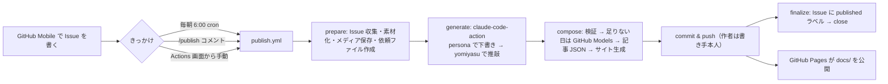

# 設計: blog-core

要件は `requirements.md`。ここでは「どう作るか」を書く。

## 1. 全体の流れ



テンプレート・CSS・JS・設定・記事 JSON の変更時は `rebuild.yml` が `scripts/build.mjs` だけを実行する（AI を呼ばない）。

## 2. ワークフロー

### 2.1 publish.yml

| 項目 | 内容 |
|---|---|
| on | `schedule: '0 21 * * *'`（UTC 21:00 = JST 6:00）、`workflow_dispatch`（inputs: `date`, `include_today`）、`issue_comment: created` |
| if | schedule / workflow_dispatch、または「コメントが `/publish` で始まり、`author_association` が OWNER / MEMBER / COLLABORATOR」 |
| permissions | `contents: write`、`issues: write`、`models: read` |
| concurrency | `group: publish`、`cancel-in-progress: false` |

ステップ:

1. `actions/checkout`（SHA 固定）
2. ImageMagick が無ければ `apt-get install imagemagick`
3. `node scripts/publish.mjs prepare` … `has_work` を出力。外部入力は `env:` で渡す（`COMMENT_BODY`、`COMMENT_AUTHOR`、`INPUT_DATE` など）。
4. `anthropics/claude-code-action`（SHA 固定、`has_work == 'true'` のとき、`continue-on-error: true`）
   - `claude_code_oauth_token: ${{ secrets.CLAUDE_CODE_OAUTH_TOKEN }}`
   - `github_token: ${{ secrets.GITHUB_TOKEN }}`（Claude GitHub App と OIDC を使わない）
   - `claude_args: --allowedTools "Read,Write,Bash(python3 .claude/skills/yomiyasu/scripts/yomiyasu_lint.py:*)"`、`ai.model` があれば `--model`
   - `show_full_output: false`、`display_report: false`
   - prompt: 「`.tmp/ai/requests/*.md` を 1 つずつ処理し、同名の `.tmp/ai/responses/<date>.json` に JSON だけを書く。他のファイルは変更しない。」
5. `node scripts/publish.mjs compose` … `published`（日付一覧）と `failed`（日付一覧）を出力
6. 変更があれば commit & push。作者は `${{ github.repository_owner }}` / `<owner_id>+<owner>@users.noreply.github.com`。メッセージは `11/7 の日記`（複数日なら `11/6, 11/7 の日記`、作り直しは `11/5 の日記を更新`）。
7. push 成功時のみ `node scripts/publish.mjs finalize`
8. `failed` が空でなければ `exit 1`（GitHub から失敗通知が届く）

### 2.2 rebuild.yml

- on: push to `main`（paths: `templates/**`, `docs/assets/css/**`, `docs/assets/js/**`, `blog.config.json`, `content/**`, `scripts/**`）、`workflow_dispatch`
- `node scripts/build.mjs` → 差分があれば commit & push。
- `GITHUB_TOKEN` による push は他のワークフローを起動しないため、publish → rebuild の連鎖や無限ループは起きない。

### 2.3 ci.yml

- on: pull_request、workflow_dispatch。`npm test` と、fixture を使ったビルド確認。

## 3. 処理の詳細（scripts/）

### 3.1 モジュール構成

| ファイル | 役割 | 副作用 |
|---|---|---|
| `lib/config.mjs` | 設定の読み込み・既定値・検証 | 読み込みのみ |
| `lib/date.mjs` | タイムゾーンと区切り時刻を考慮した日付計算、和暦表示 | なし |
| `lib/directive.mjs` | 1 行目の日付指定（`@11/5 18:30` など）の解釈 | なし |
| `lib/issues.mjs` | 本文のテキスト/メディア分解、`#タグ` 抽出、素材化、`/publish` の解釈 | なし |
| `lib/github.mjs` | REST API（fetch） | ネットワーク |
| `lib/images.mjs`, `lib/exif.mjs` | メディア保存・縮小・メタデータ除去・サイズ取得 | ファイル |
| `lib/ai.mjs` | GitHub Models / mock の呼び出し、JSON の取り出し | ネットワーク |
| `lib/writer.mjs` | プロンプト・依頼ファイル作成、検査（lint）、生成結果と素材の突き合わせ | なし |
| `lib/markdown.mjs`, `lib/html.mjs` | 最小限の Markdown → HTML、エスケープ | なし |
| `lib/template.mjs`, `lib/render.mjs`, `lib/site.mjs` | テンプレート差し込み、各ページの HTML、サイト全体の出力 | site のみファイル |
| `lib/pipeline.mjs` | collect / prepare / compose / finalize の本体 | あり |
| `publish.mjs` | CLI（サブコマンド: prepare / compose / finalize） | あり |

### 3.2 collect（対象の日付と素材を決める）

1. 開いている投稿 Issue を取得し、各 Issue の本文と書き手のコメントから素材を作る。あわせて、公開済み Issue への後からのコメントを拾うため、最近 `publish.lookbackDays`（既定 14）日以内に更新された公開済み Issue も取得する。
2. 各素材の実効日時を決める: 日付指定があればそれ（R2.3〜R2.7）、コメントなら元 Issue の日付（R2.2）、それ以外は作成日時（R2.1）。
3. **対象日付** = 未処理の素材を含む日付。未処理とは「開いている Issue の本文・コメント」または「公開済み Issue の、最後の公開以降に付いたコメント」。cron では当日を除く（R3.1）。`/publish` では当日も含む（R3.2）。`/publish 日付` ではその日だけ（R3.3）。
4. 対象日付ごとに、その日に属する全素材（公開済み Issue のものを含む）を集める（R3.4）。日付指定で他の日に移った素材も、移った先の日に集める。

「最後の公開」は記事 JSON の `generatedAt` で判断する（Issue へのコメントやラベルに状態を持たせない）。

### 3.3 素材の形

```js
{
  id: 'e1',            // その日の中での連番（時刻順に振る）
  issue: 12,
  kind: 'issue' | 'comment',
  createdAt: '2026-11-07T01:23:00Z', // 実際に書かれた日時
  at: '2026-11-07T01:23:00Z',        // 並べ替えに使う実効日時
  label: '10:23' | '追記',            // 表示する時刻
  title: '朝の散歩',                   // Issue のタイトル（コメントは空）
  segments: [ { type: 'text', text }, { type: 'media', url, alt, mediaId: 'm1' } ]
}
```

日付指定があって時刻が無い素材は、`at` をその日の最後（翌日の区切り時刻の 1 分前より後ろ、作成順）として並べる。

### 3.4 依頼ファイル（.tmp/ai/requests/YYYY-MM-DD.md）

内容の順番:

1. 役割（本人として日記を書く）
2. `config/persona.md` の全文
3. `config/samples/*.md`（合計 `ai.sampleMaxChars` 字まで。超えたら新しいファイルから順に入れる）
4. 書き直しの度合い（rewriteLevel ごとの説明文）
5. 守ること（R5.2〜R5.4）
6. 手順: ① 下書き → ② `/yomiyasu` を、文書の種類をエッセイとして下書きに適用 → ③ 自己点検（ID の対応、`[[IMG:m1]]` の残存、禁止表現）→ ④ JSON を書く
7. 出力形式（下記）
8. 素材（`[e1] 10:23 見出し: …` の形で、本文と `[[IMG:m1]]` の目印）

出力形式（応答 JSON）:

```json
{
  "title": "その日のタイトル（日付は入れない）",
  "description": "一覧用の一文（60字以内）",
  "entries": [{ "id": "e1", "heading": "小見出し（不要なら空）", "body": "本文。段落は空行区切り。[[IMG:m1]] を含む" }],
  "closing": "締めのひとこと（根拠がなければ空）"
}
```

### 3.5 compose

1. 日付ごとに `.tmp/ai/responses/<date>.json` を読み、`lint`（R5.6, R5.7）をかける。
2. 応答が無い・読めない・出来事が 1 つも対応しない日は、GitHub Models（`ai.fallback.model`、既定 `openai/gpt-4.1`）で生成する。こちらは yomiyasu を使えないため、persona と禁止表現と「守ること」だけで生成し、lint で引っかかれば 1 回だけ再依頼する。
3. それも失敗した日は `failed` に入れ、記事を書かない（R6.2）。
4. 成功した日は `merge` で素材と突き合わせ（写真の抜けを補う等）、`content/posts/<date>.json` を書く。
5. `buildSite` で docs/ を作り直し、`.publish-result.json`（公開した日付と、閉じる Issue 番号）を書く。

### 3.6 記事データ（content/posts/YYYY-MM-DD.json）

```json
{
  "date": "2026-11-07",
  "title": "...", "description": "...", "tags": ["散歩"],
  "entries": [{ "id": "e1", "label": "10:23", "at": "...", "heading": "...",
                "blocks": [{ "type": "text", "text": "..." },
                           { "type": "image", "src": "assets/media/2026/11/07-ab12cd34ef.jpg", "alt": "", "width": 1600, "height": 1200 }] }],
  "closing": "...",
  "sources": [{ "issue": 12, "url": "..." }],
  "generatedAt": "2026-11-07T21:03:00Z",
  "generator": { "provider": "claude-code" | "github-models", "model": "..." }
}
```

`generator` は記事 HTML には出さない（リポジトリ内でだけ分かる）。

### 3.7 日付指定の解釈（directive.mjs）

- 1 行目を `^@(\S+)(?:\s+(\S+))?\s*$` で取り出す。
- 日付部: `YYYY-MM-DD` / `M/D` / `昨日` / `一昨日`（`おととい` も可） / `N日前`
- 時刻部: `H:MM` / `H時` / `H時M分`（0〜29 時まで許す。24 時以降は翌日の早朝として扱い、日記上の日付は変えない）
- 時刻だけの指定（`@21時`）は、Issue 本文なら Issue の投稿日、コメントなら元 Issue の日付に当てる（R2.9）。
- 戻り値: `{ date: 'YYYY-MM-DD' | null, time: 'HH:MM' | null }` または `null`（解釈できない）。`date: null` は「日付省略」を表す。

## 4. テンプレートとフロント

### 4.1 テンプレート（templates/layout.html）

- `<!--@main-->…サンプル…<!--/@main-->` の区間をビルドで差し替える。ブラウザで直接開くとサンプルが見える（R10.1）。
- `{{name}}` は `<head>` の属性値など、コメントを置けない場所だけに使う。
- CSS/JS は `../docs/assets/...` で参照し、ビルドで `assets/...` に置き換える。JS が読む JSON の場所は `<meta name="blog-root" content="../docs/">` で渡す。

### 4.2 ページ

| ページ | 静的に出す内容 | JS で足す内容 |
|---|---|---|
| `YYYY-MM-DD.html` | 記事本文すべて | タグ一覧、左メニュー、前後リンク |
| `index.html` | 最新記事カード | タグ一覧、左メニュー |
| `archive.html` | 全記事の年月一覧 | タグ一覧、左メニュー |
| `tags.html` | 枠だけ | タグ一覧、絞り込み、結果カード |

### 4.3 docs/data/index.json

```json
{ "site": { "title": "..." }, "generatedAt": "...",
  "posts": [{ "date": "2026-11-07", "title": "...", "description": "...", "tags": ["..."], "thumb": "assets/media/..." }],
  "tags": [{ "name": "散歩", "count": 3 }],
  "ui": { "headerTagCount": 12 } }
```

1 記事あたり約 200 バイトなので、毎日書いても年 70KB 程度。分割は当面不要（1MB を超えたら年ごとの分割を検討）。

### 4.4 app.js（ライブラリなし）

- データ取得: `fetch(root + 'data/index.json')`、失敗時は静かに諦める（静的部分だけで読める）。
- 描画はすべて `createElement` + `textContent`。
- 機能: タグ一覧、左メニュー（`<details>` で折りたたみ）、前後リンク、タグページの絞り込み、ドロワー、ライトボックス、フェードイン（IntersectionObserver）、トップへ戻る、テーマ切り替え（`localStorage` は try/catch で包む）。

### 4.5 style.css

- CSS 変数でライト/ダークを定義。`prefers-color-scheme` と `data-theme` の両方に対応。
- フォントは OS 標準（ヒラギノ / Noto Sans JP / メイリオ）。
- 960px 以上で「左メニュー 240px + 本文」、未満で 1 カラム + ドロワー。

## 5. 見直した設計上の判断

| 判断 | 理由 |
|---|---|
| 1 日分をまとめて 1 回で処理し、main に直接 push | Issue ごとの PR は同じ日の HTML と index.json で競合する。書き手の手間もゼロにしたい |
| 記事の正本を JSON にして HTML は毎回作る | テンプレート変更時に AI を呼ばずに全ページ作り直せる。手での誤字修正も JSON 1 か所で済む |
| メニュー・タグは単一 JSON から JS で描画 | 記事追加のたびに既存の全 HTML を書き換えずに済む |
| タグページは 1 枚 | ファイルが増えない。検索エンジン向けには全記事一覧ページで補う |
| Issue の状態を「開いている / published ラベル」だけで管理 | Issue に自動コメントを残さない方針のため。状態の正本は記事 JSON の `generatedAt` |
| yomiyasu はリポジトリに同梱 | 実行時に外部から取得しない。中身を確認した版だけが動く |
| Claude 失敗時は GitHub Models、それも失敗なら公開しない | メモ書きがそのまま公開される事故を避ける |

## 6. 実装時に確かめること（リスク）

| 項目 | 確かめ方 | だめだった場合 |
|---|---|---|
| claude-code-action が `.claude/skills/` の同梱スキルを読み込むか | 初回の手動実行でログ（要約）を見る | 依頼ファイルに「SKILL.md を Read してから推敲する」と書き、スキル機構に頼らない |
| `GITHUB_TOKEN` の push で Pages の再デプロイが起きるか | 初回公開時 | `actions/deploy-pages` を使う構成に変える |
| GitHub Models の無料枠（1 回あたりの入力トークン上限）に収まるか | 長い日の fixture で文字数を見積もる | 素材が長い日は予備生成を諦めて失敗扱いにする |
| ImageMagick がランナーに入っているか | ワークフローで確認し、無ければ apt で入れる | JS の GPS 除去だけにする |
| cron の遅延 | 運用で確認 | 6:00 ちょうどは保証しないと README に書く |

## 7. テスト

- 単体: date / directive / issues / markdown / template / writer（lint・merge）/ exif / imageSize
- 結合: fixture の Issue とモック AI で prepare → compose を一時ディレクトリに実行し、記事 JSON と HTML を確認
- 見た目: `npm run preview` で fixture の記事を含むサイトをローカルで表示
